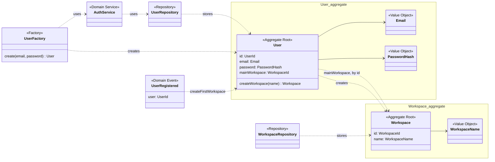
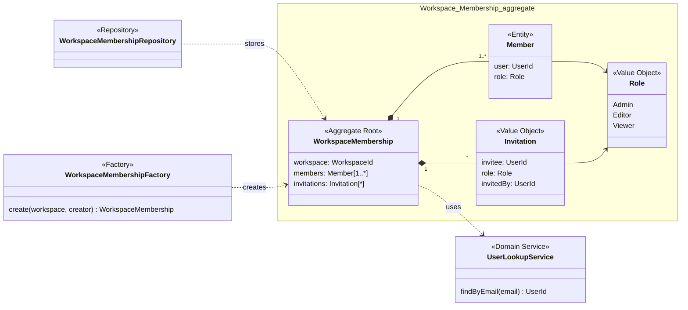
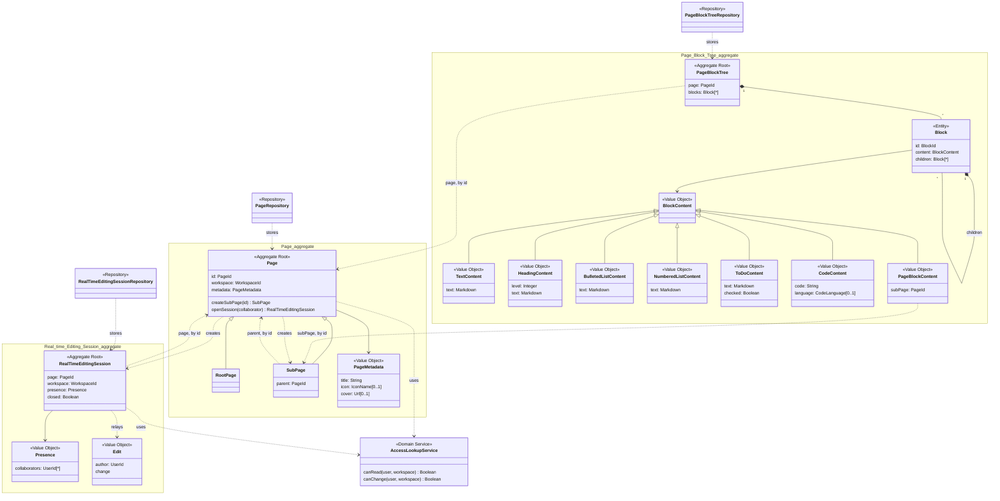
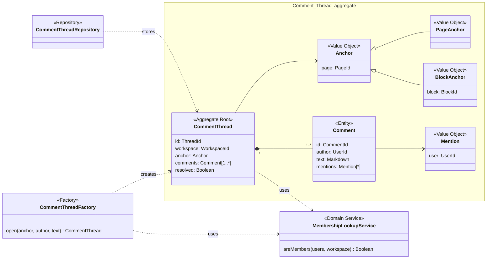
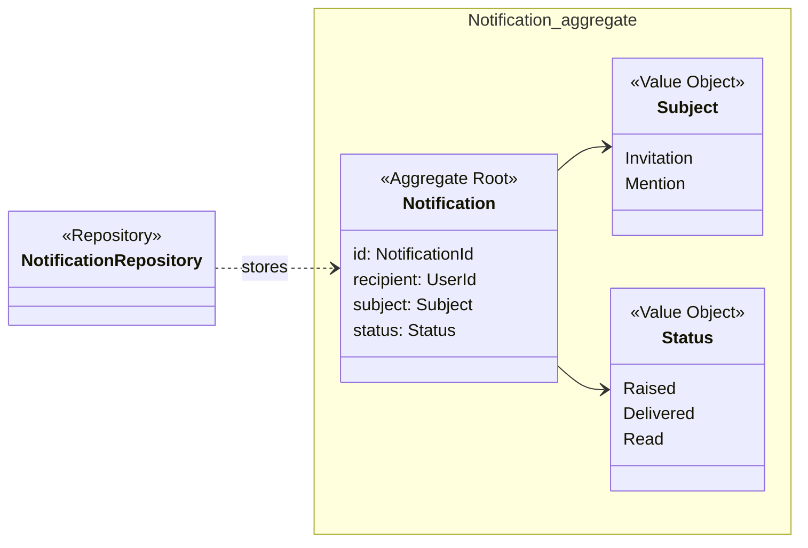

## Tactical Design

### Building blocks

Each bounded context has its own model, drawn as a UML class diagram with the DDD stereotypes `Aggregate Root`, `Entity`, `Value Object`, `Repository`, `Factory`, `Domain Service` and `Domain Event`. A box groups the classes of one aggregate. Every aggregate root has a repository that stores and loads it whole, and a factory only where creating it has a rule to keep. Of the domain events, the diagrams draw only User Registered: it is what makes Account create the first workspace of a new user on its own, with no command from the user, and make it their main one (US-01). The other events are listed in the command table of the aggregate that emits them.

Three rules shape every aggregate:

1. **Only the root is referenced from outside.** Inner entities, such as the blocks of a Page
   Block Tree, change only through a command on the root, which checks the invariants first.
2. **Aggregates refer to each other by identity.** A Page holds a `WorkspaceId`, never the
   Workspace. Across contexts the identities are the only thing shared: `UserId`, `WorkspaceId`,
   `PageId`, `BlockId`.
3. **One command changes one aggregate, in one transaction.** A rule that spans two aggregates is
   kept by a policy that reacts to an event, so it holds eventually rather than at once. Those
   rules are collected in [Rules across aggregates](#rules-across-aggregates).

For each aggregate, the commands are listed with who issues them: an actor, named by the role
the command requires, or a policy. A role is held by Membership, so the commands of the other
contexts check it from outside, as summarised in [Roles](#roles).

### Account

#### User

The identity that signs in (US-01), and the owner of the user's preferences.

- The email address is unique among users. The rule spans every User, so before a new user is created the User factory asks the `AuthService` to check the address against the `UserRepository`.
- The password is kept only as a `PasswordHash`; signing in compares against it and changes no
  state.
- The main workspace is one the user is a member of. Membership holds that fact, so the check is
  made against it, with a query to Membership (see [Roles](#roles) and [ADR-03](#adr-03-editing-keeps-a-local-copy-of-the-roles-account-and-discussion-ask-membership)). If another Admin removes the user from that workspace,
  a policy automatically sets one of their remaining workspaces as main (US-02). It changes
  the preference only if the removed workspace is still the user's main one.

| Command | Issued by | Event |
|---|---|---|
| Register | Visitor | User Registered |
| Sign in | User | User Signed In |
| Set main workspace | User; policies *whenever a user's first workspace is created, make it their main workspace* and *when a member is removed from their main workspace, set a remaining workspace as main* | Main Workspace Changed |

The main workspace is a preference of one user, while a workspace is shared by all its members.
Keeping it on Workspace, as the board did, would need a flag per member, and changing the main
workspace would update two workspaces in one transaction. The active workspace is not in the
model at all: switching workspace is a navigation choice of the client, with no rule to protect
and no policy reacting to it, served by the *Workspace directory* read model.

#### Workspace

A separate space of pages (US-02). The name is a `WorkspaceName`, never blank.

- A workspace is created by a user, through `createWorkspace` on User, so it always has a registered creator, whom Workspace Created carries. The user itself does not change, so one command still changes one aggregate: making it the main workspace stays a separate command.
- Only an Admin of the workspace renames or deletes it.
- A deleted workspace accepts no further command. Its root page and its Workspace Membership are
  removed by policies, not in the same transaction.

| Command | Issued by | Event |
|---|---|---|
| Create workspace | User; policy *whenever a user registers, create their first workspace* | Workspace Created |
| Rename workspace | Admin | Workspace Renamed |
| Delete workspace | Admin | Workspace Deleted |

### Membership

#### Workspace Membership

Who belongs to one workspace, with which role, and who has been invited to it (US-03). It is
identified by the `WorkspaceId` of its workspace.

- **A workspace always keeps at least one Admin.** Change member role, Remove member and Leave
  workspace are refused when they would leave no Admin: the last Admin has to promote another
  member before stepping down or leaving. The board had this rule as a purple sticky, but it
  forbids an operation rather than reacting to an event, so it is an invariant, not a policy.
- The membership starts with the creator of the workspace as its only member, an Admin. The `WorkspaceMembershipFactory` creates it that way, with no invitation, so there is no moment without an Admin.
- A user is a member at most once, with exactly one role.
- Only an Admin invites, changes roles and removes members. This check is local, since the roles
  live here.
- Remove member is refused if the user belongs to no other workspace (US-03). This check spans
  Workspace Membership aggregates: concurrent removals must not leave the user without a workspace.
- An invitation is addressed to a registered user, who receives it as an in-app notification (US-10), and who is neither a member nor already invited. It carries the role the invitee will have, chosen by the Admin.
- The Admin invites by email. The `UserLookupService` asks Account whether the address belongs to a registered user and gets their `UserId`; only then does the membership add the invitation. The other checks are local to the membership.
- Only the invitee accepts or declines an invitation, and either answer ends it. An invitation does not expire: it stays pending until the invitee answers. It never changes in between, and a user has at most one pending invitation per workspace, so it is a value object told apart by its invitee.

| Command | Issued by | Event |
|---|---|---|
| Create workspace membership | Policy *whenever a workspace is created, accept the creator as Admin*, carried out by the factory | Member Joined |
| Invite member | Admin | Member Invited |
| Accept invitation | Invitee | Member Joined |
| Decline invitation | Invitee | Invitation Declined |
| Change member role | Admin | Member Role Changed |
| Remove member | Admin | Member Removed |
| Leave workspace | Member | Member Left |
| Delete workspace membership | Policy *whenever a workspace is deleted, delete its membership* | Workspace Membership Deleted |

### Editing

#### Page

A document of a workspace, with its metadata and its place in the page tree (US-04, US-05).

- **A page is either the root page of its workspace or a sub-page.** `RootPage` and `SubPage` are the two forms of the one root of the Page aggregate, and a page never turns from one into the other. Only a sub-page has a parent, and it always has one.
- **Each workspace has exactly one root page.** It is created only by the policy on Workspace Created and deleted only by the policy on Workspace Deleted. Its `PageId` is derived from the `WorkspaceId`, so a second root page of the same workspace would have the same identity and cannot be stored: the rule holds without looking at the other pages.
- **A sub-page is created, moved and deleted only through its page block.** Inserting, moving or
  deleting the page block in the tree of the parent page fires the matching command on Page. Each
  sub-page therefore has exactly one page block, and nothing flows back from Page to the block,
  so the loop raised while reviewing the board cannot happen.
- The parent of a sub-page is the page whose tree holds its page block, in the same workspace. The parent creates it, through `createSubPage` on Page, so the sub-page always gets the workspace of its parent, and the `PageId` that its page block already holds. The parent itself does not change, so one command still changes one aggregate.
- Deleting a page is final (US-04): its content and its sub-pages are deleted with it, by
  policies. A page knows its parent but not its sub-pages, which only the page blocks of its tree
  name, so the deletion goes through the tree: the tree of the page is deleted, and each sub-page
  whose page block it held is deleted in turn, down to the last level.
- The metadata is set only on the page itself. The page block shows the title, icon and cover
  through the read model, without keeping a copy, so nothing in the block has to follow it.
- Setting the metadata on the page itself needs a role that may change the content. The roles live in Membership, so Page asks the `AccessLookupService`, which only says whether a user of the workspace can read the content or also change it. It reads a local copy of the roles, fed by the events of Membership, and asks Membership only when the copy has no row ([ADR-03](#adr-03-editing-keeps-a-local-copy-of-the-roles-account-and-discussion-ask-membership)).
- The title is plain text. Icon and cover are optional. The icon is the name of an icon from the Lucide set, which the client draws, so the page stores no image. The cover is a link to an image, because no story asks for uploading files.

| Command | Issued by | Event |
|---|---|---|
| Create page | Policies *whenever a workspace is created, create its root page* and *whenever a page block is inserted, create the sub-page* | Page Created |
| Set title, icon, cover | Editor | Page Metadata Changed |
| Move page | Policy *whenever a page block is moved, move it in the tree as well* | Page Moved |
| Delete page | Policies *whenever a page block is deleted, delete the page as well*, on Block Deleted and on Block Tree Deleted, and *whenever a workspace is deleted, delete its root page* | Page Deleted |

#### Page Block Tree

The content of one page (US-06, US-07). It is identified by the `PageId` of its page and starts empty together with it. It needs no factory: no command creates it, and the first operation finds it empty and stores it.

The tree is replicated ([ADR-01](#adr-01-replicas-merge-concurrent-edits-with-our-own-crdt-editing-relays-the-operations)). Every client that has the page open holds a replica and applies its own edits to it at once, and Editing holds the replica that decides what the others get. An edit is an operation of our CRDT, the same package in the client and in Editing ([ADR-04](#adr-04-editing-runs-on-nodejs-with-the-crdt-of-the-client-the-other-services-on-go)): insert, update, move or delete a block, or edit the text of a block. Editing takes the operations of a page one at a time. For each one it checks the rules below on its replica, appends the operation to the session log ([ADR-02](#adr-02-editing-acknowledges-an-operation-once-it-is-in-a-durable-log)) and applies it to its replica before it takes the next. The check therefore always runs on a replica that holds every operation accepted so far: only the snapshots of the tree lag behind the log, not the replica in memory.

The rules fall into two groups, by how they can be broken.

**Kept by the CRDT.** Two concurrent operations, each valid on the replica of its author, can break these rules only together. Editing cannot refuse either of them, because each one passes the check on its own, so the CRDT keeps the rules on every replica by construction:

- The blocks form an ordered tree: every block has exactly one parent, the page or another
  block, and a position among its siblings. Two blocks inserted at the same position at once
  end up in the same order on every replica.
- A block cannot be nested under itself or one of its descendants. When two concurrent moves
  would make a cycle (A under B while B goes under A), every replica orders the moves by their
  timestamps and the one that would close the cycle has no effect, after Kleppmann et al.,
  "A highly-available move operation for replicated trees".
- Deleting a block deletes the blocks nested in it, including a block moved under it at the
  same time. An operation on a deleted block has no effect.

**Checked by Editing.** One operation can break these rules on its own. Editing refuses it before any other replica sees it, together with the later operations of the same author that build on it, and the author reverts them:

- The type of a block is the subtype of its `BlockContent`, and each subtype holds only the fields its type needs. Text is Markdown (BR-03), so a heading also has its level, from 1 to 6 as in Markdown. A to-do has its checkbox, and a page block holds only its sub-page, so no other block can refer to one. A code block keeps its code as plain text, not Markdown, and may name its language in one word, the one written after the opening fence of a Markdown code block (`python`). Editing refuses a field that the type does not have and a value out of its range, such as a heading of level 7.
- The editor of the client works on styled text, not Markdown, so Editing refuses a style that Markdown cannot express, and the Markdown of BR-03 loses nothing (see [Editing client](implementation.html#editing-client)).
- Update block can turn a block into another type by replacing its content. The block keeps its `BlockId`, its place in the tree and the comment threads anchored to it. Page blocks are the exception: no block becomes a page block and a page block becomes nothing else, because a sub-page is created and deleted only by inserting and deleting its page block. For the same reason, Editing refuses a page block inserted with the `PageId` of a page that already exists. A page block holds nothing but its sub-page, which never changes, so Editing also refuses any update of a page block.

**Events come from the effect of an operation, not from the operation.** Editing derives them from what the operation changed on its replica, so a move that has no effect emits no Block Moved.

- Block Deleted is emitted for every deleted block, because Discussion deletes the threads
  anchored to it. It lists the page blocks removed with it, so that every sub-page underneath
  is deleted, not only the top one.
- Block Tree Deleted lists the page blocks the tree held, for the same reason: it is how the
  sub-pages of a deleted page are found and deleted.
- Block Inserted and Block Moved are emitted only for page blocks, which the
  policies on Page follow. The edits of the other blocks stay in the session log.

A new block type is a new subtype of `BlockContent` and its rendering, both inside Editing, with no change to any other aggregate or context (QA-09). The content is saved as the name of its type plus its fields, so a new type needs no change to the persistence schema, as long as its edits fit the generic operations of the CRDT (ADR-01).

| Command | Issued by | Event |
|---|---|---|
| Insert block | Collaborator, as an operation through *Submit edit* | Block Inserted, for a page block |
| Update block | Same | None: the operation stays in the session log |
| Move or nest block | Same | Block Moved, for a page block that moved |
| Delete block | Same | Block Deleted |
| Edit text | Same | None: the operation stays in the session log |
| Delete block tree | Policy *whenever a page is deleted, delete its block tree* | Block Tree Deleted |

#### Real-time Editing Session

The shared editing of one page (US-08). It is identified by the `PageId` of its page. As agreed
while reviewing the board, the session exists even with a single collaborator: the first Join
session opens it, so editing alone and editing together follow the same path.

- Opening goes through `openSession` on Page, so a session exists only for a page that exists, and it starts with the collaborator who joined in its presence. It keeps the workspace of its page, which never changes, for the checks on later joins and edits. The page itself does not change, so one command still changes one aggregate.
- Only a collaborator who has joined can submit edits, and only with a role that may change the content. A Viewer can join to follow the edits and appear in the presence, but cannot submit. The session, and Page when it opens one, ask the `AccessLookupService` whether whoever joins can read the content and whoever submits an edit can also change it.
- The session does not merge. Every replica merges concurrent edits on its own with a CRDT of
  ours, which settles PP-01
  ([ADR-01](#adr-01-replicas-merge-concurrent-edits-with-our-own-crdt-editing-relays-the-operations)),
  so the `change` carried by an `Edit` is an operation of that CRDT. Submit edit checks that the
  author has joined the open session with a role that may change the content, then hands the
  operation to the [Page Block Tree](#page-block-tree), which checks it against its own rules
  and applies it. The session itself does not change, so one command still changes one
  aggregate. An accepted operation is appended to the session log and acknowledged, and only
  then relayed to the other collaborators
  ([ADR-02](#adr-02-editing-acknowledges-an-operation-once-it-is-in-a-durable-log)). Every
  collaborator converges to the same content, and no acknowledged edit is dropped (QA-05).
- A closed session accepts no join and no edit. It is closed when its page is deleted, and the
  collaborators learn it from Session Closed itself: the *notify its participants* of the policy
  is that event, not an in-app notification, which US-10 keeps for invitations and mentions.

| Command | Issued by | Event |
|---|---|---|
| Join session | Collaborator | Session Joined |
| Leave session | Collaborator; policy *when a member is removed or leaves, or the workspace membership is deleted, make them leave the sessions of the workspace* | Session Left |
| Submit edit | Editor | The events of the Page Block Tree |
| Close session | Policy *when a page is deleted, close its editing session and notify its participants* | Session Closed |

### Discussion

#### Comment Thread

A conversation attached to a page or to one of its blocks (US-09).

- The anchor is fixed when the thread opens and never changes. A page anchor holds a thread on the whole page, a block anchor a thread on one block. Both name the page, because a `BlockId` alone does not tell Discussion which page the block is on, and the threads of a page must be found when it is shown or deleted.
- A thread is never empty: the `CommentThreadFactory` opens it together with its first comment.
- A resolved thread accepts no new comments.
- A mention names a member of the workspace. The members live in Membership, so the thread and its factory ask the `MembershipLookupService` whether the author of a comment, every user it mentions and whoever resolves the thread are members, all in one query to Membership ([ADR-03](#adr-03-editing-keeps-a-local-copy-of-the-roles-account-and-discussion-ask-membership)).
- Any member of the workspace posts and resolves, whatever their role: a comment does not
  change the content of the page, so a Viewer can take part in the discussion too.

| Command | Issued by | Event |
|---|---|---|
| Post comment | Collaborator | Comment Posted |
| Resolve thread | Collaborator | Thread Resolved |
| Delete thread | Policies *whenever a page is deleted, delete its comment threads* and *whenever a block is deleted, delete its comment threads* | Thread Deleted |

### Notification

#### Notification

A message telling one user about an invitation or a mention (US-10).

- The status only moves forward: Raised, then Delivered, then Read.
- Delivery is best effort and may be repeated: delivering an already delivered notification
  changes nothing.
- Only the recipient marks it as read.
- Mentioning oneself raises nothing: the policy fires only when *another* user is mentioned.

| Command | Issued by | Event |
|---|---|---|
| Raise notification | Policies *when MemberInvited then send the invitation* and *when another user is mentioned* | Notification Raised |
| Deliver notification | Policy *notification delivery with best effort* | Notification Delivered |
| Mark as read | User | Notification Read |

### Rules across aggregates

The rules that span more than one aggregate, and the policies that keep them. Between the event
and the reaction the rule does not hold yet: right after Workspace Created, for instance, the
root page may not exist, and the read models must allow for it.

| Rule | Kept by | Traces to |
|---|---|---|
| A new user has a workspace, and it is their main one | *Whenever a user registers, create their first workspace*; *whenever a user's first workspace is created, make it their main workspace* | US-01, US-02 |
| Removing a member leaves them in at least one workspace and replaces their main one if needed | Remove member checks that another workspace membership remains; *when Member Removed concerns the user's current main workspace, automatically set a remaining workspace as main* | US-02, US-03 |
| A workspace has an Admin from its creation | *Whenever a workspace is created, accept the creator as Admin* | US-03 |
| A workspace has exactly one root page | *Whenever a workspace is created, create its root page*, plus the identity of the root page, derived from its workspace | US-04 |
| Every page block has its sub-page, and every sub-page its page block | *Whenever a page block is inserted, moved or deleted…* | US-04 |
| Deleting a workspace deletes everything in it | *Whenever a workspace is deleted, delete its root page*, then the cascade below; *whenever a workspace is deleted, delete its membership* | US-02, PP-05 |
| Deleting a page deletes its content, sub-pages, session and threads | *Whenever a page is deleted, delete its block tree*, then *whenever a page block is deleted, delete the page as well* for each page block the tree held; *when a page is deleted, close its editing session*; *whenever a page is deleted, delete its comment threads* | US-04, US-09, PP-05 |
| Deleting a block deletes the threads anchored to it | *Whenever a block is deleted, delete its comment threads* | US-09, PP-05 |
| A member who is no longer one stops following the edits | *When a member is removed or leaves, or the workspace membership is deleted, make them leave the sessions of the workspace* | US-03, QA-06 |
| Invited and mentioned users are told | *When MemberInvited then send the invitation*; *when another user is mentioned* | US-10 |

### Roles

The roles live in Membership, but most of the commands that need them belong to other contexts.
The table states which role each command requires; the relations that carry them are in the
[Context Map](#context-map), and how the roles reach the other contexts is settled by [ADR-03](#adr-03-editing-keeps-a-local-copy-of-the-roles-account-and-discussion-ask-membership).

| Command | Context | Admin | Editor | Viewer |
|---|---|---|---|---|
| Rename workspace, Delete workspace | Account | ✓ | | |
| Invite member, Change member role, Remove member | Membership | ✓ | | |
| Leave workspace | Membership | ✓ | ✓ | ✓ |
| Set title, icon, cover; Submit edit | Editing | ✓ | ✓ | |
| Join session | Editing | ✓ | ✓ | ✓ |

Three more checks read Membership without a role: the main workspace of a user is one the user
is a member of, only a member posts a comment or resolves a thread, and a mention names a member
of the workspace.

### Changes from the board

The model refines the board, and these changes are to be carried back to it:

- *Set main workspace* moves from Workspace to User, and *Switch workspace* with *Workspace
  Switched* leave the model, as explained under [User](#user).
- *Rename workspace* → *Workspace Renamed* is added, as US-02 requires.
- *Decline invitation* → *Invitation Declined* settles PP-02, and *Leave workspace* → *Member
  Left* settles PP-03. The sticky *not possible to leave the workspace if you are last Admin*
  becomes an invariant of Workspace Membership.
- The deletion policies of Membership and Discussion, with *Workspace Membership Deleted* and
  *Thread Deleted*, settle PP-05.
- The Editor no longer issues *Move page* and *Delete page*: the Editor moves or deletes the page
  block, and the policies do the rest.
- *Edits Merged* and the policy *when edits are merged, apply them to the page block tree*
  leave the model: every replica merges on its own, and Submit edit hands each operation to the
  Page Block Tree, which checks and applies it
  ([ADR-01](#adr-01-replicas-merge-concurrent-edits-with-our-own-crdt-editing-relays-the-operations)).
- Moving a sub-page under a different parent page is not modelled: a page block moves only within
  the tree of its own page.
